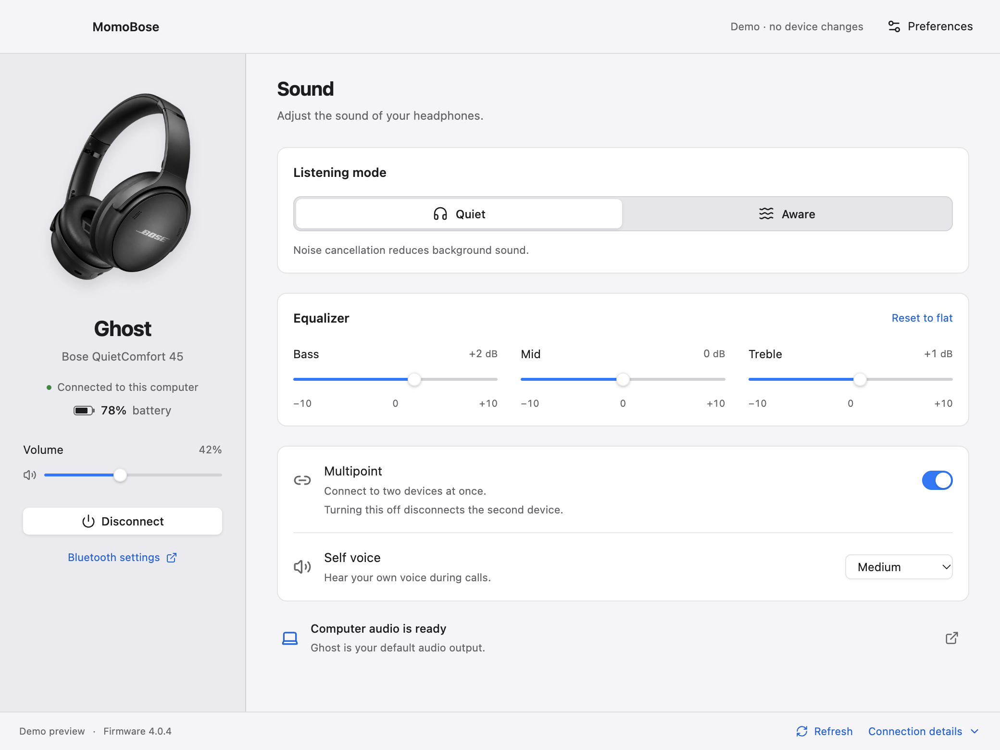
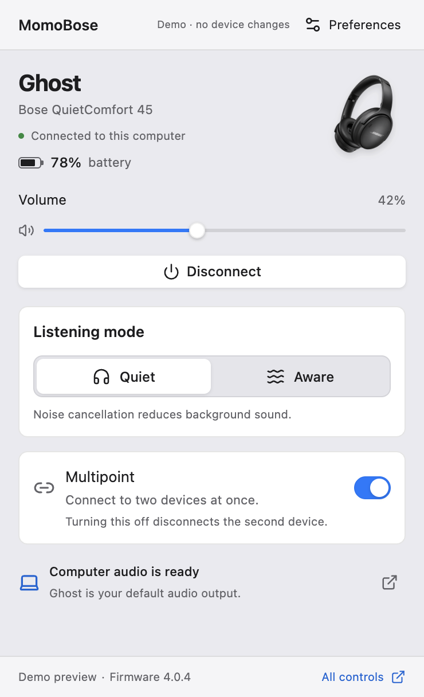
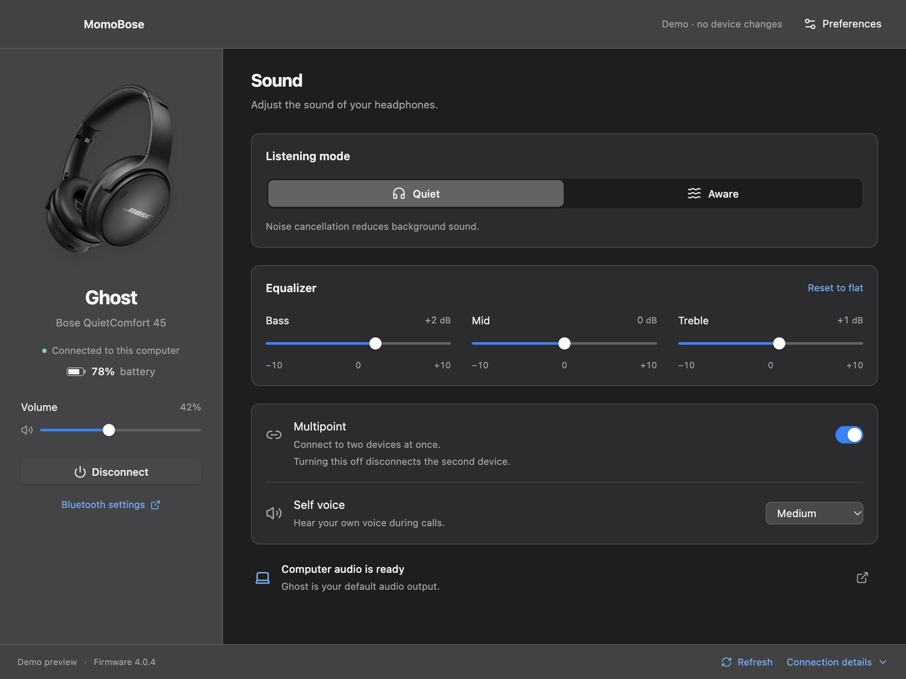
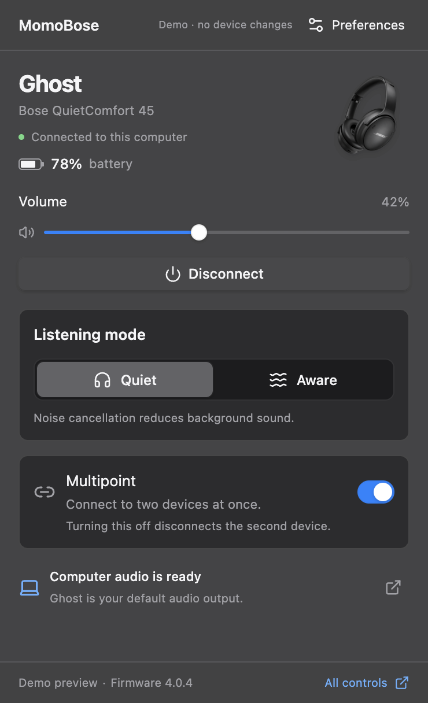
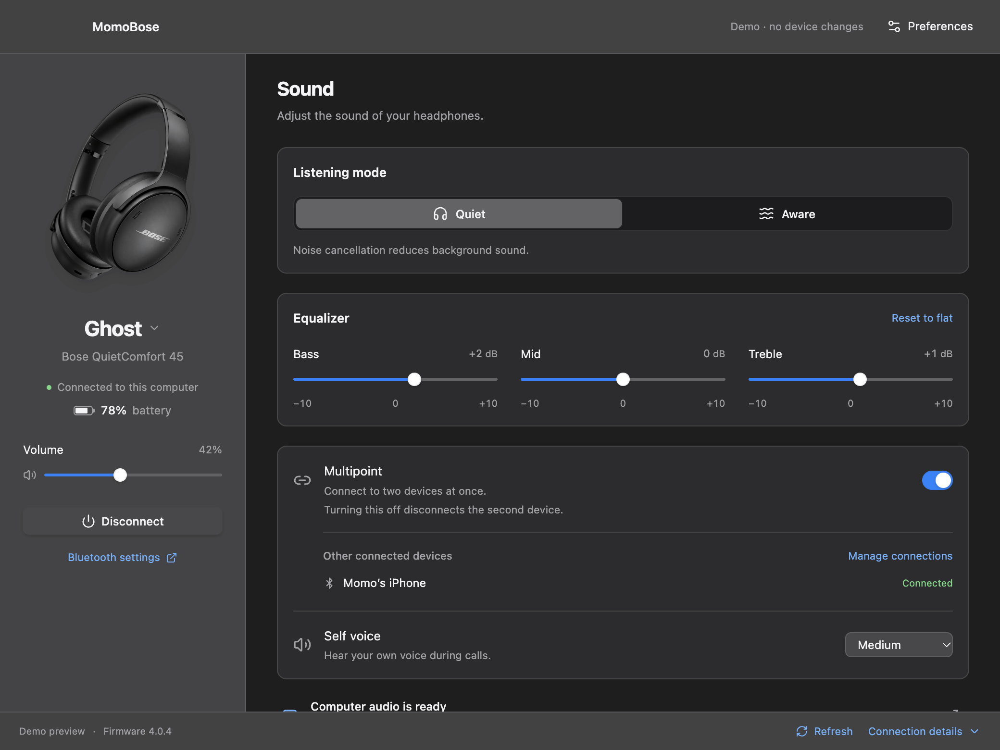

# MomoBose

[](https://github.com/OmarSerrah/MomoBose/actions/workflows/build.yml)
[](package.json)
[](LICENSE)

MomoBose is a desktop companion for Bose QuietComfort 45, Sony WH-1000XM4/WH-1000XM5, and Apple AirPods. It provides quick controls from the macOS menu bar or Windows system tray, plus a full desktop window. The app runs locally and stores preferences on your computer.

> The Windows control is a system tray flyout. On macOS it is a menu bar popover.

On macOS, press **Cmd+W** or close the desktop window to keep MomoBose running in the menu bar and remove its Dock icon. Choose **Open MomoBose** from the menu bar icon's right-click menu to bring the full window and Dock icon back. **Cmd+Q** quits the app.

## Why use MomoBose

- View headphone battery and connection/audio status.
- Control QC45 Quiet/Aware mode, three-band EQ, multipoint, self voice, and volume.
- Control Sony ANC/Ambient/Off, five-band EQ with Clear Bass and presets, multipoint, ambient level, focus on voice, Speak-to-Chat, touch controls, wearing detection, and DSEE Extreme when reported by the headset.
- Connect or switch between paired devices and manage QC45 multipoint sources.
- Control AirPods connection and volume; macOS also shows left, right, and case battery levels when available.
- Choose light, dark, or system appearance, and optionally reconnect after interruptions or launch at login.
- No account, cloud service, analytics, or firmware changes.

AirPods ANC, Adaptive Audio, Spatial Audio, Find My, and Apple account switching remain in Apple system controls. Windows can identify renamed headphones when their paired hardware IDs are available; otherwise it uses recognizable model names. Per-ear/case battery readings are macOS-only. Windows runtime behavior should be checked on physical hardware.

Sony support is experimental: both protocol versions have automated coverage, but neither Sony model has been tested with this build on physical hardware. Keep the model name (`WH-1000XM4` or `WH-1000XM5`) in the paired device name, and close Sony Sound Connect on your phone before connecting controls. Source management depends on the firmware's reported capabilities. Adjustable Bose-style self voice is unavailable on these Sony models. See [Sony support and hardware checks](docs/sony.md).

## Screenshots

| Appearance | Desktop window | Menu bar / system tray widget |
| --- | --- | --- |
| Light |  |  |
| Dark |  |  |

### Check connected Bose devices

Connect MomoBose to your QC45 and enable **Multipoint** in the full desktop window. Under **Other connected devices**, the app lists the other devices currently connected to the headphones. Select **Manage connections** to see all paired sources: connected devices are marked **Connected**, while saved pairings that are not active are marked **Paired · not connected**. The list shows how many of the QC45's two connection slots are in use.



## Get started

### Install a release

Download the installer or archive for your operating system from [GitHub Releases](https://github.com/OmarSerrah/MomoBose/releases). Pair your headphones in macOS Bluetooth settings or Windows Bluetooth settings before opening MomoBose. MomoBose does not perform initial Bluetooth pairing.

### App updates

Starting with 0.1.13, installed builds check GitHub Releases shortly after startup
and every four hours. You can also choose **Check for Updates…** from the app or
tray menu, or **Preferences → App updates**.

- **Windows installer:** updates download in the background. Choose **Restart to
  Update** when ready; the installer replaces MomoBose and reopens it. Closing
  the window or quitting normally does not install an update.
- **macOS and Windows ZIP:** when a newer release is available, choose **Download
  Update** to open its download page, then install it manually. macOS releases
  currently use ad-hoc signing; automatic replacement requires Developer ID
  signing and is not enabled.

Preferences stay on your computer across updates. Update checks contact GitHub
for public release metadata and do not send headphone details. Development,
demo, and smoke-test sessions do not check for updates. Users of 0.1.12 and older
must install an updater-enabled release manually first.

See [release and updater maintenance](docs/updates.md) for the release process
and the two-version validation checklist.

### Run from source

Requirements:

- Node.js 22.12 or newer and npm.
- macOS 12 or newer with Apple Command Line Tools (`xcode-select --install`), or Windows 10/11 with the .NET 8 SDK.
- A paired Bose QC45, Sony WH-1000XM4/WH-1000XM5, or supported AirPods for hardware use. The demo runs without Bluetooth hardware.

```sh
git clone https://github.com/OmarSerrah/MomoBose.git
cd MomoBose
npm ci
npm run build:native
npm run build
npm start
```

During development, start the Vite and Electron processes with:

```sh
npm run dev
```

The browser preview does not access Bluetooth. To explore simulated controls, use either:

```sh
npm run demo                  # Electron desktop demo
npm run dev:ui                # then open http://127.0.0.1:5173/?demo=1
```

Add `&widget=1` to the browser demo URL to view its compact layout. The demo is explicitly simulated and does not send Bluetooth commands.
Add `&sony=xm4` or `&sony=xm5` to preview the corresponding Sony controls and artwork.

### Build installers

```sh
npm run dist:mac   # run on macOS; DMG and ZIP for the current architecture
npm run dist:win   # run on Windows; installer and ZIP
```

## Help and documentation

- Check [VALIDATION.md](VALIDATION.md) for platform checks, known limitations, and hardware validation status.
- Check [THIRD_PARTY_NOTICES.md](THIRD_PARTY_NOTICES.md) for artwork and dependency notices.
- For bugs or setup questions, open a [GitHub issue](https://github.com/OmarSerrah/MomoBose/issues) and include your OS version, app version, and the steps to reproduce. Do not include Bluetooth addresses or other private device information.

## Contributing and maintenance

MomoBose is maintained by **Momo**. Contributions are welcome. Before opening a pull request:

1. Open an issue to discuss larger changes, especially changes to device protocol behavior.
2. Keep platform-specific native code and shared UI/state logic in their existing areas (`native/`, `electron/`, and `src/`).
3. Run the checks and build:

   ```sh
   npm run typecheck
   npm test
   npm run build
   ```

4. Describe the change, platforms affected, and any hardware validation performed. Automated protocol tests do not confirm behavior on a physical headset; state clearly when hardware checks have not been done.

The project uses the [MIT License](LICENSE). See [docs/artwork.md](docs/artwork.md) for asset guidance.
